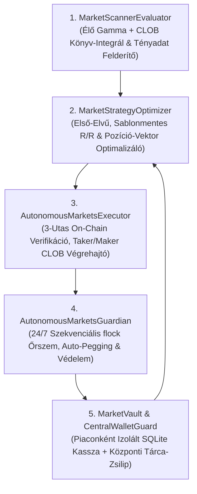

# Autonóm Polymarket Multi-Option, Futures & NegRisk Quant Engine — Alkotmány és Mesterterv

**Frissítve:** 2026-11-10  
**Státusz:** 100% Anchoring-Mentes, Túlirányítás-Mentes, Bizonyítás-Alapú Rendszeralkotmány (`100% Standalone Repository`)

---

## 1. Legfelsőbb Küldetés és A Három Megszeghetetlen Alaptörvény (`Supreme Core Mandate`)

A rendszer egyetlen legfőbb küldetése: **minden egyes beküldött vagy vizsgált Polymarket piacon — bármiféle előzetes sablon, túlirányító megkötés vagy emlékezetből vett feltételezés nélkül, kizárólag élő adatokra és matematikai bizonyításra támaszkodva — megtalálni és felépíteni a legmagasabb hozam/kockázat (`Risk/Reward`) arányú, profitábilis megoldást (ha az adott piacon ilyen reálisan létezik), amelyben a legrosszabb esetbeli veszteség minimalizált, a reális és maximális profit pedig maximalizált.**

### 1.1. A Három Megszeghetetlen Alaptörvény

1. **Minden Nemű Túlirányító, Megkötő és Befolyásoló Anchoring Abszolút Tilalma (`Total Ban on Structural, Numeric & Template Anchoring`):**
   - A rendszer a kezdeti, nyílt fejlődési fázisában van: **szigorúan tilos bármilyen előre rögzített pozícióépítési sablont, kötelező kosárméretet, előre definiált halmaz-sémát, fix százalékos küszöböt, zárójeles példafelsorolást vagy múltbeli piacokról átmásolt receptet ráerőltetni egy új piacra.**
   - Minden újonnan vizsgált piac teljesen tiszta lappal (`Tabula Rasa`), önálló matematikai és mikrostrukturális problémaként indul. Az AI-nak teljes kognitív és módszertani szabadsága van — és egyben kötelessége —, hogy az adott piac saját elszámolási szabályából, hátralévő időtartamából, könyvmélységéből és fundamentális folyamatából **első elvekből (`first principles`) vezesse le a lehető legjobb, profitábilis megoldást**.

2. **A Profitábilis Megoldás Megtalálása Mindenekfelett — Valós `Risk/Reward` Optimalizáció (`Relentless Solution Discovery & R/R Maximization`):**
   - Új piac beadásakor kizárólag a fő gazdasági és matematikai célok érvényesek:
     1. **A legrosszabb esetbeli veszteség minimalizálása ($\min \text{MaxLoss}_{\text{guarded}}$),**
     2. **A reális várható profit ($\max \mathbb{E}[\text{PnL}_{\text{real}}]$) és a maximális elérhető profit ($\max \text{MaxProfit}$) maximalizálása,**
     3. **A valós hozam/kockázat arány ($\max \text{R/R} = \frac{\mathbb{E}[\text{PnL}_{\text{real}}]}{\text{MaxLoss}_{\text{guarded}}}$) maximalizálása.**
   - Ha egy piacon az azonnali, nyers megközelítés nem optimális, a rendszernek tilos reflexből feladnia: meg kell vizsgálnia a piac szabályaiból, könyvmélységéből és hátralévő időtartamából ($T - t_0$) levezethető összes matematikailag és végrehajtásilag reális megoldási teret.
   - **Őszinte, Bizonyított `GO` vs. `NO-GO`:** Ha létezik matematikailag és végrehajtásilag **valóban reális**, profitábilis, jó `Risk/Reward` megoldás, akkor a rendszer azt köteles megtalálni és kidolgozni (`GO`). Ha viszont a tételes bizonyítás azt mutatja, hogy a piac hátralévő időtartama ($T - t_0$), árazási telítettsége vagy könyvmélysége miatt semmilyen reális, jó `Risk/Reward` arányú megoldás nem érhető el, akkor a helyes és elfogadott döntés a bizonyítással alátámasztott **`NO-GO`**.

3. **Szigorú Élő-Adat és Bizonyítási Invariáns — Soha Nem Emlékezetből (`Zero-Memory & Mandatory Proof Rule`):**
   - **Soha, semmilyen elemzés, esélybecslés, árazás vagy döntés nem alapulhat a nyelvi modell belső emlékezetén, korábbi beszélgetésen vagy ellenőrizetlen feltételezésen.**
   - Minden egyes állítást az adott pillanatban lekérdezett, levágás (`truncation`) nélkül ellenőrzött élő API-adatokból és egzakt matematikai levezetéssel **kell bizonyítani**.

---

## 2. Önálló Rendszerarchitektúra (`100% Standalone Repository`)

| Dimenzió | Autonóm Polymarket Multi-Market & Futures Engine (`polymarket-futures-and-regrisk-markets`) |
| :--- | :--- |
| **Git Repository** | **100% önálló, dedikált Git repository:** `git@github.com:xbtblvrg/polymarket-futures-and-regrisk-markets.git` |
| **Fő feladat** | Bármely Polymarket CLOB esemény és piac első-elvű elemzése, felépítése és autonóm végigkereskedése |
| **Időhorizont** | Tetszőleges ($[t_0, T]$, a piac valós hátralévő időtartamához és dinamikájához igazítva) |
| **Tőkeallokáció** | **Nincs statikus egyedi tétplafon**; piac-specifikus, névre szóló tőkeallokáció ($B_{m,0}$ kezdőtőke + $\Delta B_{m,t}$ rátöltések) |
| **Végrehajtási mód** | **100% Autonóm, Piaconként Izolált CLOB végrehajtás** (`src/pm_markets_engine/`) |
| **Adatbázis-Izoláció** | Piaconként különálló SQLite adatbázis: `data/pm_markets/<market_slug>.sqlite3` + központi tárca-zsilip: `data/pm_markets/_wallet_guard.sqlite3` |
| **Vezérlés & Szabályzat** | Chat-vezérelt jóváhagyás + jelen `Master Blueprint` (`Zero-Anchoring, Zero-Memory & Proof-First` alkotmány) |

---

## 3. Kötelező Bizonyítási Protokoll Új Piac Vizsgálatakor (`Proof-First Evaluation Protocol`)

Minden újonnan beküldött vagy szkennelt piacnál a rendszernek — mindenféle előre gyártott sablon nélkül — az alábbi **4 matematikai és empirikus bizonyítási lépést** kell végrehajtania:

1. **1. Lépés — Levágásmentes Élő Tény- és Könyv-Felderítés (`Live Untruncated State & Orderbook Discovery`):**
   - Lekérdezi a piac összes opcióját, pontos elszámolási szabályát (`resolution rules`), hátralévő időtartamát ($T - t_0$), valamint minden releváns opció teljes élő CLOB vételi (`Bid Ladder`) és eladási (`Ask Ladder`) könyvét, a tényleges árlépésközt (`orderPriceMinTickSize`) és a minimum megbízási méretet (`min_order_size`).
   - Lekérdezi a piac mögöttes folyamatának összes releváns, aktuális külső tényadatát.
2. **2. Lépés — Első-Elvű Megoldáskeresés Teljes Szabadsággal (`Unconstrained First-Principles Solution Search`):**
   - A nyers tényadatokból és a piaci árakból kiindulva első elvekből levezeti, hol van a piacon **valódi matematikai félreárazás (`Edge`) vagy strukturális aszimmetria**, és melyik $\mathbf{q} \ge \mathbf{0}$ pozíció- és végrehajtási vektor adja a legmagasabb valós `Risk/Reward` arányt (egymást kizáró és nem kizáró kimeneteli állapottereket egyaránt pontosan kezelve).
3. **3. Lépés — Szigorú Realitás- és Könyv-Integrál Bizonyítás (`Strict Realism & Book-Integral Proof`):**
   - Minden vizsgált megoldási tervre egzaktul, kívülről bemondott konstansok nélkül bizonyítja:
     - **A valós belépési költséget és átlagárat (`VWAP`):** Az eladási könyv integráljából ($\int_0^{q_i} \text{Ask}_i(u)\,du$) vagy — passzív `Maker` építésnél — a valószínűségi axiómákkal ($\sum_{\omega \in \Omega} P(\omega) = 1$) és a hátralévő időtartammal ($T - t_0$) konzisztens, reálisan teljesülő árszintekből.
     - **A valós likvidációs értéket és a védett maximális veszteséget ($\text{MaxLoss}_{\text{guarded}}$):** Kizárólag az élő vételi könyv (`Bid Ladder`) kumulatív integráljából ($\sum_i \int_0^{q_i} \text{Bid}_i(u, t)\,du$) és az alapfolyamat két kereskedési ablak közötti maximális kedvezőtlen elmozdulásából ($\Delta p_i$). Ha egy piacon nincs köztes likvid kiszállási ablak (diszkontinuus ugráskockázat) vagy a `Bid` könyv nem nyeli el a pozíciót, a rendszer a teljes befektetett tőkét tekinti valós kockázatnak.
4. **4. Lépés — A 4 Kötelező Kimeneteli Szám Prezentálása:**
   - Minden javasolt megoldásnál (és minden összehasonlított alternatívánál) kötelezően kimutatja:
     1. **Maximális veszteség ($\text{MaxLoss}_{\text{guarded}}$ és naiv lejáratkori kockázat),**
     2. **Maximális elérhető profit ($\text{MaxProfit}$),**
     3. **Reális várható profit ($\mathbb{E}[\text{PnL}_{\text{real}}]$),**
     4. **Valós `Risk/Reward` arány ($\text{R/R}_{\text{effective}}$) és az ebből következő `GO / NO-GO` ítélet.**

---

## 4. Aktív Életciklus-Menedzsment és Matematikai Védőfékek ($t_0 \to T$)

Amikor egy piacon `GO` döntés és felhasználói jóváhagyás születik, az autonóm rendszer a nyitástól a lezárásig (`t_0 -> T`) az adott piac saját dinamikájára szabottan menedzseli a pozíciót, három általános matematikai védőfékkel:

1. **`Monotonic Value Guard` (Túlkereskedés és Spread-Elvérzés Tilalma):**
   - A rendszer kizárólag akkor hajthat végre átcsoportosítást, részleges profit-lefölözést (`Swing Trim`) vagy súlymódosítást, ha a tranzakciós `Bid/Ask` spread és csúszás levonása után a pozíció garantált kifizetési küszöbe vagy kockázattal korrigált várható értéke **szigorúan javul**.
2. **`Dynamic Adverse-Move & Breakout Shield` (Folyamatos Állapot- és Kockázatfigyelés):**
   - Az autonóm őrszem (`AutonomousMarketsGuardian`) folyamatosan figyeli az élő eredményeket, a fundamentális mutatókat és a CLOB vételi/eladási könyveket; ha egy nem tartott kimenetel erősödni kezd vagy egy tartott láb fundamentuma megromlik, még korai, likvid fázisban végrehajtja a fedezést vagy a védett kiszállást.
3. **`Hard Budget & No-Naked-Leg Invariant`:**
   - A rendszer soha nem lépheti túl a felhasználó által az adott piacra jóváhagyott tőkekeretet, soha nem hagyhat hátra csonka, fedezetlen rész-pozíciót, és bármikor azonnal megállítható.

---

## 5. Az Autonóm Szoftverrendszer Moduláris Felépítése (`src/pm_markets_engine/`)



1. **[`scanner_evaluator.py`](file:///Users/belavarga/polymarket-futures-and-regrisk-markets/src/pm_markets_engine/scanner_evaluator.py) (`MarketScannerEvaluator`):** Levágásmentes Gamma és CLOB `/book` lekérdező, egzakt `Ask` és `Bid` könyv-integrál számító (`integrate_ask_ladder`, `integrate_bid_ladder`), dinamikus `tick_size` és `min_order_size` kiolvasással.
2. **[`strategy_optimizer.py`](file:///Users/belavarga/polymarket-futures-and-regrisk-markets/src/pm_markets_engine/strategy_optimizer.py) (`MarketStrategyOptimizer`):** Sablonok és beégetett konstansok nélkül, tiszta könyv-integrálokból és valószínűségekből számítja bármely első elvekből felépített $\mathbf{q}$ pozíció-vektor valós bekerülési költségét, `MaxProfit`, `Realistic Profit`, `MaxLoss_guarded` és `R/R` mutatóit, valamint ellenőrzi a `Monotonic Value Guard` feltételt.
3. **[`pm_markets_executor.py`](file:///Users/belavarga/polymarket-futures-and-regrisk-markets/src/pm_markets_engine/pm_markets_executor.py) (`AutonomousMarketsExecutor`):** Önálló L1/L2 `ClobClient` végrehajtó, 3-utas on-chain tárca-egyeztetéssel és 3-oszlopos végrehajtási jelentéssel.
4. **[`guardian.py`](file:///Users/belavarga/polymarket-futures-and-regrisk-markets/src/pm_markets_engine/guardian.py) (`AutonomousMarketsGuardian`):** Szekvenciális `flock` zár alatt futó háttér-őrszem (`Auto-Pegging`, 3-utas szinkronizáció és kockázatvédelem).
5. **[`market_vault.py`](file:///Users/belavarga/polymarket-futures-and-regrisk-markets/src/pm_markets_engine/market_vault.py) & [`wallet_guard.py`](file:///Users/belavarga/polymarket-futures-and-regrisk-markets/src/pm_markets_engine/wallet_guard.py):** Piaconként különálló SQLite főkönyv és központi tárca-zsilip.
6. **[`ai_council_cli.py`](file:///Users/belavarga/polymarket-futures-and-regrisk-markets/src/pm_markets_engine/ai_council_cli.py) (`AICouncilCLI`):** A Multi-AI Quant Council (`gpt-6-astra`, `claude-opus-5-5`, `grok-4.7`) szigorú, anchoring-mentes CLI meghívó és ellenőrző modulja.

---

## 6. Önálló CLOB Végrehajtás, 3-Utas On-Chain Verifikáció és Piaconkénti Izoláció

### 6.1. A 3-Utas Atomi Igazság-Egyeztetés (`Three-Way Truth Reconciliation Loop`)
A rendszer **soha nem bízik vakon** abban, hogy egy beküldött megbízás (`post_order`) valóban teljesült. Minden $m \in \mathcal{M}$ piac minden művelete előtt, közben és után három független adatforrást egyeztet össze:

1. **Tervezett Cél-Vektor (`Target Position State` — $\mathbf{q}_m^{\text{target}}$ az adott $m$ piac saját `data/pm_markets/<market_slug>.sqlite3` adatbázisában):**
   - Az adott $m$ piacra jóváhagyott terv szerinti cél-darabszám ($q_{m,i}^{\text{target}}$) és maximális megengedett bekerülési ár ($\bar{p}_{m,i}$).
2. **Valódi On-Chain Tárca-Készlet (`Verified Wallet Inventory` — $\mathbf{q}_m^{\text{wallet}}(t)$):**
   - Közvetlenül lekérdezve a hitelesített `ClobClient.get_balance_allowance(BalanceAllowanceParams(asset_type=AssetType.CONDITIONAL, token_id=i, signature_type=1))` végpontról (amely közvetlenül a `POLYMARKET_PROXY` tárca `ERC-1155` kondicionális token-egyenlegét olvassa ki), kiegészítve a szabad `USDC.e` fedezettel (`AssetType.COLLATERAL, signature_type=1`).
   - Kizárólag a fizikailag a tárcában lévő (`settled on-chain`) share-ek számítanak ténylegesen birtokolt pozíciónak.
3. **Élő CLOB Nyitott Megbízások (`Live CLOB Open Orders` — $\mathbf{q}_m^{\text{open}}(t)$):**
   - Közvetlenül lekérdezve a `get_open_orders()` és `get_order(order_id)` végpontokról.
   - Minden $i \in S_m$ lábra a rendszer folyamatosan számítja mind a **Tárca-Elszámolási Hiányt (`Wallet Settlement Shortfall`)**, mind a **Fedezetlen / Még Ki Nem Helyezett Hiányt (`Unplaced Discrepancy`)**:
     $$\text{WalletShortfall}_{m,i}(t) = q_{m,i}^{\text{target}} - q_{m,i}^{\text{wallet}}(t), \qquad \Delta q_{m,i}^{\text{unplaced}}(t) = \max\!\left(0,\; q_{m,i}^{\text{target}} - \left( q_{m,i}^{\text{wallet}}(t) + q_{m,i}^{\text{open}}(t) \right)\right)$$
   - Egy végrehajtási ciklus **kizárólag akkor** kap `VERIFIED_ON_CHAIN` státuszt, ha minden $i \in S_m$ lábra:
     $$\left| q_{m,i}^{\text{target}} - q_{m,i}^{\text{wallet}}(t) \right| \le \epsilon_{\text{dust}} \quad \text{és} \quad q_{m,i}^{\text{open}}(t) = 0$$

### 6.2. Adaptív Protokoll Nem Teljesülő Megbízásokra és 3-Oszlopos Chat-Igazolás
Amikor egy `Maker` limit megbízás nem teljesül azonnal ($\text{WalletShortfall}_{m,i}(t) > 0$):
1. **Automatikus Mikro-Utánhúzás (`Auto-Pegging / Cancel & Replace`):** Ha a nyitott `Maker` limit elé magasabb `Bid` kerül, de az új `Best Bid` $+\,\Delta p_{\text{tick}, i}$ még nem lépi túl a láb maximális célárát ($\bar{p}_{m,i}$), a rendszer automatikusan módosítja a limitet.
2. **Matematikai Újratervezés Elmozduló Ár Esetén (`Dynamic Strategy Re-Optimization`):** Ha a piaci könyv elmozdul, a rendszer a már tárcában lévő ($\mathbf{q}_m^{\text{wallet}}$) pozíció és a szabad kassza ($\text{AvailableCash}_m$) peremfeltételével első elvekből újraoptimalizálja a hátralévő pozíció-vektort a legmagasabb valós `Risk/Reward` arány elérése érdekében.
3. **3-Oszlopos Hitelesített Chat-Jelentés (`3-Column Verified Execution Receipt`):**
   - **1. Tervezett Pozíció (`Target Plan`)** | **2. Tárcában Hitelesített Pozíció (`On-Chain Wallet Verified`)** | **3. Nyitott CLOB Megbízások & Korrekciós Státusz (`Open Orders & Reconciliation Action`)**.

### 6.3. Kétszintű Piac- és Tárca-Izoláció (`Per-Market Isolated DBs + Central Wallet Guard`)
1. **1. Szint — Piaconkénti Külön Adatbázis (`1 Piac = 1 Saját SQLite Fájl`):**
   - Minden elindított $m \in \mathcal{M}$ piac saját SQLite adatbázist kap (`data/pm_markets/<market_slug>.sqlite3`), saját zárt kassza-könyveléssel:
     $$\text{TotalUnspentCash}_m(t) = \text{ApprovedDeposits}_m(t) - \text{NetBuyCost}_m(t) + \text{RealizedSellProceeds}_m(t)$$
     $$\text{AvailableCash}_m(t) = \text{TotalUnspentCash}_m(t) - \text{OpenBuyLocks}_m(t)$$
   - Minden $B_{m,0}$ kezdőtőke és $\Delta B_{m,t}$ rátöltés névre szólóan a felhasználó által megnevezett $m$ piac adatbázisába kerül, és minden $m$ piac a saját egyedi stratégiáját futtatja.
2. **2. Szint — Központi Tárca-Zsilip (`data/pm_markets/_wallet_guard.sqlite3`):**
   - **A) Kettős Fedezet-Ellenőrzés (`Maker-Collateral & Solvency Guard`):**
     $$\text{TrulyUnallocatedWalletUSDC}(t) = \text{WalletUSDC}_{\text{on-chain}}(t) - \sum_{k \in \mathcal{M}} \text{TotalUnspentCash}_k(t) \ge \Delta B_{m,t}$$
     $$\text{OrderCost} \le \text{AvailableCash}_m(t) \quad \text{és} \quad \text{OrderCost} + \sum_{k \in \mathcal{M}} \text{OpenBuyLocks}_k(t) \le \text{WalletUSDC}_{\text{on-chain}}(t)$$
   - **B) Globális `token_id` és `order_id` Tulajdonosi Zár:** Egy `token_id` egyszerre csak egyetlen piac adatbázisához tartozhat; globális `cancel_all()` és `cancel_market_orders()` meghívása kód-szinten tiltott (`RuntimeError`).
   - **C) Szekvenciális `flock` Végrehajtási Mutex:** Egyetlen központi háttér-ciklus (`AutonomousMarketsGuardian`) járja végig sorban, atomi `flock` fájlzár mellett a különálló piac-adatbázisokat.
   - **D) Külső Tárca-Folyamatok Teljes Érintetlensége:** A közös tárcán esetlegesen párhuzamosan futó bármely külső rendszerhez, annak megbízásaihoz vagy tőkéjéhez soha nem nyúl hozzá.

---

## 7. Alkotmányos Alapirányelvek, Multi-AI CLI Szerződés és Mérnöki Invariánsok

1. **Elsődleges Pénzügyi Optimalizáció és Episztémikus Invariáns:**
   - A cél a portfólió folyamatos kamatos növekedése és a `Risk/Reward` maximalizálása a védett maximális tőkevisszaesés ($\text{MaxLoss}_{\text{guarded}}$) minimalizálásával.
   - A profit matematikai optimalizációs cél, **soha nem garantált ígéret vagy a veszteség elvi lehetetlenségének állítása**.
2. **Zéró Beégetett Korlát (`The Anti-Constant Mandate`):**
   - Önkényes, statikusan beégetett ársapkák, diszkrét szűrők vagy fix kosárméret-állandók használata szigorúan tilos.
3. **Zéró Fizetős Külső Adatforrás (`$0.00 External Data Cost`) és Multi-AI Quant Council CLI Szerződés (`config/ai_council_contract.json` & `src/pm_markets_engine/ai_council_cli.py`):**
   - Fizetős külső adatforrásra vagy API-ra előfizetni vagy azt javasolni **szigorúan tilos (`$0.00` külső adatköltség)**; kizárólag ingyenes, nyilvános API-k használhatók.
   - **Multi-AI Hierarchia (`2026-10-06`, `2026-10-13`, `2026-10-17`):**
     - **Gemini Antigravity (`agy` — `/Users/belavarga/.local/bin/agy`):** Elsődleges kvantitatív agy (`primary`), vezető rendszermérnök és végső kiadási hatóság, állandó autonóm fejlesztési felhatalmazással.
     - **OpenAI Codex (`gpt-6-astra` — `/Users/belavarga/.local/bin/codex`):** Másodlagos/helyettes (`secondary / deputy`) matematikai modellező.
     - **Anthropic Claude (`claude-opus-5-5` — `/Users/belavarga/.local/bin/claude`):** Másodlagos (`secondary`) folyamat-mechanikai specialista és 1:1 kód-szintézis tartalék (`fallback`).
     - **xAI Grok (`grok-4.7` — `/Users/belavarga/.local/bin/grok`):** Harmadlagos (`tertiary`) red-team ellenoldali auditor.
   - **Kötelező, Shell-Injekciótól Mentes CLI Meghívási Szignatúrák (`shell=False`, izolált `empty cwd`, szolgáltatónkénti `flock` zár és `Streaming Watchdog`):**
     - **`gpt-6-astra` (`codex` CLI):**
       ```text
       /Users/belavarga/.local/bin/codex exec --sandbox read-only --skip-git-repo-check --ephemeral --color never --model gpt-6-astra "<PROMPT>"
       ```
     - **`claude-opus-5-5` (`claude` CLI, a `<PROMPT>` `stdin`-en átadva):**
       ```text
       /Users/belavarga/.local/bin/claude --print --safe-mode --restricted --tools "" --strict-mcp-config --no-session-persistence --output-format json --model claude-opus-5-5
       ```
     - **`grok-4.7` (`grok` CLI):**
       ```text
       /Users/belavarga/.local/bin/grok --prompt-file <brief.txt> --tools "" --no-subagents --no-memory --disable-web-search --permission-mode dontAsk --deny "*" --max-turns 1 --output-format json --verbatim --model grok-4.7
       ```
   - **Modell-Azonosító, Tool-Tilalom és `agy` SHA-256 Diszpozíció:** Segéd-CLI válasz csak akkor fogadható el, ha a visszaigazolt modell pontosan `gpt-6-astra` vagy `claude-opus-5-5`, nem történt eszköz- vagy szubágens-hívás (`permission_denials == []`, `subagent_stats.spawned == 0`), és az eredményt az `agy` SHA-256 lenyomattal felülvizsgálja (`used`, `partly_used`, `rejected`).
4. **Az Anchoring és Példafelsorolási Torzítás Szigorú Rendszerszintű Tilalma (`2026-11-04 User Directive`):**
   - Szigorúan tilos bármilyen AI promptban, elemzésben vagy specifikációban előre lehorgonyozni a modellt konkrét megoldási receptekkel, példafelsorolásokkal vagy zárójeles sugallatokkal (`validate_zero_anchoring_prompt`). A promptoknak kizárólag a nyers empirikus tényeket, az élő könyvadatokat és az objektív matematikai célt szabad tartalmazniuk.
5. **Anti-Tautologikus Tesztelési és Zéró-Regressziós Invariáns (`2026-10-29 User Directive`):**
   - Tilos az önigazoló, körkörös tesztelés. Minden tesztnek független matematikai invariánsok ($\sum P_i = 1$, könyv-integrálok, kettős fizetőképesség, monoton kifizetési érték, 3-utas on-chain egyezés) ellen kell validálnia, 100%-os tesztsikerrel.
6. **Megváltoztathatatlan Főkönyv (`Immutable Ledger`):**
   - Minden tőkeallokáció, beküldött megbízás, teljesülés és tárca-szinkronizáció megváltoztathatatlan rekord az adott piac SQLite adatbázisában (`data/pm_markets/<market_slug>.sqlite3`).
